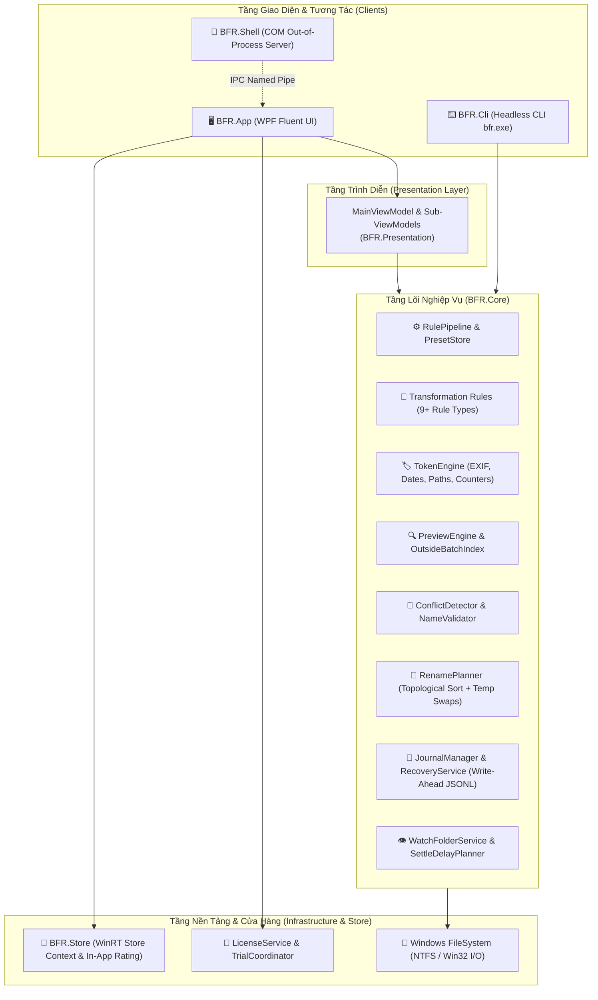

# 🚀 BFR — Batch File Renamer

> **Fast, Safe, and Modern Batch File & Folder Renaming for Windows 10 & 11**  
> *Công cụ đổi tên hàng loạt tệp và thư mục an toàn tuyệt đối, tốc độ cực cao với bảng xem trước thời gian thực, khôi phục sự cố tự động và giao diện Fluent Design chuẩn mực.*

[](https://dotnet.microsoft.com/)
[](https://learn.microsoft.com/dotnet/csharp/)
[-0078D6?style=for-the-badge&logo=windows&logoColor=white)](https://microsoft.com/windows)
[](packaging/msix/)
[-success?style=for-the-badge&logo=checkmarx&logoColor=white)](tests/)
[](src/)
[](PRIVACY_POLICY.md)

---

## 📑 Mục lục / Table of Contents
1. [🌟 Giới thiệu Tổng quan (Overview)](#-giới-thiệu-tổng-quan-overview)
2. [✨ Tính năng Nổi bật (Key Features)](#-tính-năng-nổi-bật-key-features)
3. [🏛️ Kiến trúc Hệ thống (Architecture & Design)](#️-kiến-trúc-hệ-thống-architecture--design)
4. [🛠️ Bộ Quy tắc & Token Engine (Rules & Token Engine)](#️-bộ-quy-tắc--token-engine-rules--token-engine)
5. [🖥️ Giao diện Người dùng (Modern Fluent UI)](#️-giao-diện-người-dùng-modern-fluent-ui)
6. [⌨️ Công cụ Dòng lệnh (CLI Reference)](#️-công-cụ-dòng-lệnh-cli-reference)
7. [📊 Ma trận Tính năng Free vs Pro (Feature Matrix)](#-ma-trận-tính-năng-free-vs-pro-feature-matrix)
8. [⚡ Kiểm chuẩn Hiệu năng Thực tế (Performance Benchmarks)](#-kiểm-chuẩn-hiệu-năng-thực-tế-performance-benchmarks)
9. [📂 Cấu trúc Thư mục Dự án (Project Structure)](#-cấu-trúc-thư-mục-dự-án-project-structure)
10. [🚀 Hướng dẫn Cài đặt & Build (Getting Started & Build)](#-hướng-dẫn-cài-đặt--build-getting-started--build)
11. [🛡️ Chính sách Bảo mật & Quyền riêng tư (Privacy & Security)](#️-chính-sách-bảo-mật--quyền-riêng-tư-privacy--security)

---

## 🌟 Giới thiệu Tổng quan (Overview)

**Batch File Renamer (BFR)** là tiện ích Windows thế hệ mới được thiết kế đặc biệt nhằm giải quyết triệt để bài toán tổ chức, chuẩn hóa và đổi tên hàng nghìn tệp tin hoặc thư mục chỉ trong tích tắc. 

Khác biệt với các công cụ truyền thống tiềm ẩn nguy cơ mất dữ liệu khi xảy ra xung đột hay mất điện đột ngột, BFR đặt **sự an toàn tuyệt đối của dữ liệu người dùng (Zero Data Loss)** làm nguyên lý cốt lõi:
- **Xem trước thời gian thực (Real-time Reactive Preview):** Mọi điều chỉnh tham số quy tắc được phản hồi ngay lập tức trên bảng xem trước kèm tô sáng khác biệt (Diff highlighting).
- **Phát hiện xung đột thông minh (Conflict Detection Engine):** Tự động phát hiện va chạm trùng tên nội bộ trong lô, va chạm với tệp có sẵn ngoài đĩa, tên thiết bị cấm của Windows (`CON`, `PRN`, `AUX`, `NUL`, `COM1-9`, `LPT1-9`) và vượt giới hạn chiều dài đường dẫn NTFS (`MAX_PATH = 260`).
- **Lập lịch đổi tên Topo an toàn (Topological Rename Planner):** Tự động phân tích đồ thị phụ thuộc và giải quyết hoàn hảo các chuỗi hoán đổi vòng lặp (`A -> B -> A`, `file1 -> file2 -> file3 -> file1`) thông qua tệp đệm an toàn mà không làm mất dữ liệu.
- **Nhật ký giao dịch ghi trước (Write-Ahead Journal):** Ghi nhật ký từng bước trước khi can thiệp vào hệ thống tệp. Nếu có sự cố (mất điện, crash hệ điều hành), ứng dụng tự động nhận diện và khôi phục nguyên trạng hoặc tiếp tục hoàn tất lô đổi tên.
- **Hoàn tác đa bước (1-Click Multi-Step Undo):** Khôi phục trạng thái tệp về nguyên vẹn trước đó bất kỳ lúc nào.

---

## ✨ Tính năng Nổi bật (Key Features)

| Phân hệ | Chi tiết tính năng |
| :--- | :--- |
| ⚡ **Hiệu năng Vượt trội** | Preview 10.000 tệp trong **~54 ms**; Preview 100.000 tệp chỉ mất **~292 ms** với bộ nhớ RAM cấp phát dưới **73 MB**. |
| 🛡️ **An toàn Dữ liệu Tuyệt đối** | Cơ chế Write-Ahead Journaling (JSONL) chống mất file khi sập nguồn; kiểm tra tệp ngoài lô, chống trùng tên và kiểm tra ký tự cấm. |
| 🔄 **Giải quyết Xung đột Vòng lặp** | Thuật toán sắp xếp Topo ngược với bộ tệp hoán đổi tạm thời, giải quyết triệt để bài toán hoán đổi tên chéo nhau. |
| 🧩 **Hơn 9 Loại Quy tắc Toàn diện** | Tìm & thay thế, Biểu thức chính quy (Regex với timeout 250ms chống ReDoS), Đánh số thứ tự (La Mã, tiền tố 0), Chèn ký tự, Cắt tỉa (Trim), Hoa/Thường (Title, Sentence), Chuẩn hóa Tiếng Việt (NFC/Slug/Bỏ dấu), Phần mở rộng, Mẫu tên (Template). |
| 🏷️ **Token Engine Đa Năng** | Đổi tên linh hoạt dựa trên `{name}`, `{ext}`, `{orig}`, `{n:n}`, `{parent}`, `{created:fmt}`, `{modified:fmt}`, `{taken:fmt}` (EXIF hình ảnh), `{size}`, `{rand:n}`. |
| 📂 **Menu Chuột Phải Windows Explorer** | Tích hợp sâu vào menu chuột phải Windows 10 & Windows 11 thông qua **COM LocalServer Out-Of-Process** độc lập, khởi động nhanh và nạp hàng loạt đường dẫn. |
| 👁️ **Watch Folder (Tự động hóa Thư mục - Pro)** | Tự động phát hiện và áp dụng preset cho tệp mới phát sinh trong thư mục theo dõi, trang bị **Settle Delay (1500ms)** và cơ chế **Anti-Looping** chống đổi tên lặp lại. |
| 🎨 **Giao diện Windows 11 Fluent** | Thiết kế Mica/Acrylic cao cấp, thanh tiêu đề tràn viền, thẻ quy tắc phong cách PowerToys với công tắc gạt Toggle, sắp xếp cột xem trước, menu ngữ cảnh trên từng dòng. |
| 🌐 **Đa Ngôn ngữ Đồng bộ** | Hỗ trợ 4 ngôn ngữ chuẩn xác: **Tiếng Việt (`vi`)**, **English (`en`)**, **Français (`fr`)**, **简体中文 (`zh-Hans`)**. |
| 💻 **CLI Tự động hóa (`bfr.exe`)** | Bộ lệnh dòng lệnh đầy đủ cho DevOps, sysadmin và người dùng script (`bfr rename`, `bfr undo`, `bfr history`, `bfr watch`, `bfr preset`, `bfr license`). |

---

## 🏛️ Kiến trúc Hệ thống (Architecture & Design)

Hệ thống được xây dựng theo mô hình **Clean Architecture & Separation of Concerns**, đảm bảo tầng nghiệp vụ (Core) hoàn toàn độc lập với giao diện đồ họa (WPF), dòng lệnh (CLI) và môi trường đóng gói (MSIX/Store).



### Chi tiết các dự án thành phần (Project Breakdown):
- **`BFR.Core`**: Lõi nghiệp vụ độc lập, chứa toàn bộ thuật toán quy tắc, token, bộ phân tích xung đột, sắp xếp topo, quản lý nhật ký giao dịch và theo dõi thư mục. Không phụ thuộc UI.
- **`BFR.Presentation`**: ViewModels thuần túy tuân thủ mô hình MVVM, xử lý dữ liệu bảng preview, debounce 150ms và kiểm thử tự động UI logic.
- **`BFR.App`**: Ứng dụng Desktop WPF hiện đại với phong cách Windows 11 Fluent Design, hiệu ứng trong suốt Mica/Acrylic, bộ thẻ quy tắc WinUI 3 và tương tác mượt mà.
- **`BFR.Cli`**: Giao diện dòng lệnh độc lập `bfr.exe`, xuất kết quả JSON/CSV/Text, hỗ trợ chế độ xem trước `--dry-run` và mã thoát chuẩn mực.
- **`BFR.Shell`**: Máy chủ COM Out-of-Process cục bộ xử lý tương tác từ context menu File Explorer mà không phụ thuộc vào .NET Runtime bên ngoài.
- **`BFR.Store`**: Tích hợp Windows Store APIs cho giấy phép IAP (In-App Purchase) bản quyền trọn đời và giao diện đánh giá ứng dụng trực tiếp (In-App Rating & Review).

---

## 🛠️ Bộ Quy tắc & Token Engine (Rules & Token Engine)

### 1. Danh mục 9 quy tắc chuyển đổi tên
| Quy tắc | Mô tả tham số & Khả năng |
| :--- | :--- |
| **Tìm & Thay thế (Find & Replace)** | Thay thế chuỗi văn bản, phân biệt hoa/thường, hỗ trợ biểu thức chính quy (Regex) với cơ chế phòng ngừa ReDoS (Timeout 250ms). |
| **Đánh số thứ tự (Numbering)** | Bắt đầu từ số tuỳ ý, bước nhảy, đệm số 0 (padding), kiểu số: Ả Rập (`01, 02...`), La Mã (`I, II, III...`), chữ cái (`A, B...`). Đặt ở đầu, cuối hoặc vị trí tùy chỉnh. |
| **Chèn ký tự (Insert)** | Chèn chuỗi cố định hoặc token động vào vị trí cụ thể từ đầu tên hoặc tính ngược từ cuối tên. |
| **Cắt tỉa (Trim)** | Xóa khoảng trắng thừa, xóa N ký tự đầu/cuối, cắt khoảng ký tự từ vị trí A đến B, hoặc lọc bỏ các ký tự đặc biệt do người dùng chỉ định. |
| **Chuyển đổi hoa/thường (Case)** | `UPPERCASE`, `lowercase`, `Title Case`, `Sentence case`, bảo toàn các từ ngoại lệ (viết tắt CNTT như `API`, `SQL`, `MSIX`). |
| **Chuẩn hóa & Bỏ dấu (Sanitize)** | Bỏ dấu tiếng Việt (`Nguyễn` ➔ `Nguyen`), chuyển đổi thành URL Slug (`huong-dan-cai-dat`), chuẩn hóa Unicode Unicode NFC/NFD. |
| **Ngày tháng & Thời gian (Date)** | Thêm dấu thời gian theo định dạng (`yyyy-MM-dd_HHmmss`) lấy từ: Ngày tạo tệp, Ngày sửa đổi, Ngày chụp EXIF (`TakenDate`), hoặc Thời điểm hiện tại (`Now`). |
| **Phần mở rộng (Extension)** | Thay đổi phần mở rộng tệp, đồng bộ chữ hoa/thường cho đuôi file (`.JPG` ➔ `.jpg`), hoặc xóa bỏ phần mở rộng. |
| **Mẫu tên (Template)** | Kết hợp sức mạnh của Token Engine để định nghĩa lại toàn bộ cấu trúc tên tệp theo công thức người dùng. |

### 2. Cẩm nang Token Engine (Cheat Sheet)
| Token | Ý nghĩa | Ví dụ thực tế |
| :--- | :--- | :--- |
| `{name}` | Tên tệp gốc hiện tại (không kèm đuôi) | `Report_Draft` |
| `{orig}` | Tên tệp nguyên bản ban đầu trước khi qua chuỗi quy tắc | `IMG_001` |
| `{ext}` | Phần mở rộng tệp (không có dấu chấm) | `jpg`, `pdf`, `docx` |
| `{parent}` | Tên của thư mục cha chứa tệp | `Project_2026` |
| `{n}` | Số thứ tự tăng dần theo lô | `1, 2, 3...` |
| `{n:3}` | Số thứ tự có đệm 0 cố định (3 chữ số) | `001, 002, 003...` |
| `{created:yyyy-MM-dd}` | Ngày tạo tệp theo định dạng tùy chọn | `2026-10-28` |
| `{modified:HH-mm-ss}` | Giờ sửa đổi cuối cùng của tệp | `14-30-05` |
| `{taken:yyyyMMdd}` | Ngày chụp ảnh từ siêu dữ liệu EXIF (Máy ảnh / Điện thoại) | `20251231` |
| `{size}` | Dung lượng tệp định dạng thân thiện | `4.2 MB`, `15 KB` |
| `{rand:6}` | Chuỗi ký tự ngẫu nhiên bảo mật (độ dài n) | `a8f9c2` |

---

## 🖥️ Giao diện Người dùng (Modern Fluent UI)

Phiên bản mới nhất mang đến giao diện được tái thiết kế toàn diện chuẩn mực **Windows 11 Fluent Design**:
- **Borderless Mica Titlebar:** Thanh tiêu đề tích hợp nút điều khiển mượt mà, hòa nhập với phông nền mờ Acrylic/Mica.
- **Rule Cards phong cách PowerToys / WinUI 3:**
  - Nút công tắc **Toggle Switch** giúp bật/tắt từng quy tắc trong tích tắc mà không cần xóa đi cấu hình lại.
  - Tóm tắt tham số ngắn gọn, trực quan trên đầu thẻ.
  - Hỗ trợ kéo-thả để thay đổi thứ tự ưu tiên trong chuỗi quy tắc.
- **Bảng Xem Trước (Preview Table) Nâng Cấp:**
  - **Tri-State Checkbox Header:** Ô chọn / bỏ chọn tất cả nhanh chóng ở đầu bảng.
  - **Sắp xếp theo Cột (Column Sorting):** Nhấp chuột vào bất kỳ tiêu đề cột nào (Tên cũ, Tên mới, Trạng thái, Thư mục) để sắp xếp tăng/giảm dần ngay lập tức.
  - **Pill Badges Màu Sắc Sinh Động:** Trạng thái tệp thể hiện bằng huy hiệu trực quan (`🟢 Sẽ đổi`, `⚪ Không đổi`, `🔴 Trùng/Lỗi`) kết hợp tô sáng vùng thay đổi (Diff highlighting).
  - **Menu Chuột Phải Ngữ Cảnh (Context Menu):** Nhấp chuột phải vào dòng tệp bất kỳ để Mở tệp, Xem trong File Explorer, Sao chép tên hoặc Xóa khỏi danh sách.
- **Bảng Lệnh Nhanh (Command Palette - `Ctrl + K`):** Tìm kiếm và thực thi bất kỳ thao tác nào bằng bàn phím.
- **In-App Store Rating:** Đánh giá và để lại nhận xét trực tiếp cho ứng dụng trên Microsoft Store mà không cần mở trình duyệt web.

---

## ⌨️ Công cụ Dòng lệnh (CLI Reference)

BFR cung cấp công cụ dòng lệnh đầy đủ tính năng `bfr.exe` dành cho các kịch bản tự động hóa và người dùng chuyên nghiệp:

### 1. Đổi tên hàng loạt tệp (`bfr rename`)
```powershell
# Đổi tên với preset có sẵn và kiểm tra trước (dry-run)
bfr rename "D:\Photos" --preset "Ảnh theo ngày chụp" --dry-run

# Đổi tên trực tiếp và xuất kết quả ra file JSON
bfr rename "D:\Documents" --preset "Chuẩn hóa tên" --format json > result.json

# Đổi tên từ danh sách tệp lớn (vượt giới hạn tham số Windows)
bfr rename --file-list "C:\Temp\filelist.txt" --preset "Đánh số"
```

### 2. Tự động theo dõi thư mục (`bfr watch`)
```powershell
# Theo dõi thư mục Downloads, tự động đổi tên tệp JPG theo preset khi tệp được tải xong
bfr watch "C:\Users\Admin\Downloads" --preset "Đánh số theo thứ tự" --include "*.jpg" --settle 2000
```

### 3. Quản lý Hoàn tác & Lịch sử (`bfr undo` & `bfr history`)
```powershell
# Xem 5 phiên đổi tên gần nhất
bfr history --limit 5

# Hoàn tác phiên đổi tên gần nhất
bfr undo

# Hoàn tác theo ID phiên cụ thể
bfr undo --batch-id "3fa85f64-5717-4562-b3fc-2c963f66afa6"
```

### 4. Đăng ký Menu Chuột Phải Explorer (`bfr context-menu`)
```powershell
# Kiểm tra trạng thái đăng ký COM Context Menu
bfr context-menu status

# Đăng ký tích hợp chuột phải cho phiên bản Portable
bfr context-menu register

# Hủy đăng ký chuột phải
bfr context-menu unregister
```

---

## 📊 Ma trận Tính năng Free vs Pro (Feature Matrix)

| Tính năng | Phiên bản Free | Phiên bản Pro (Trọn đời) |
| :--- | :---: | :---: |
| **Số lượng quy tắc trong một chuỗi** | Tối đa 3 quy tắc | **Không giới hạn** |
| **Độ sâu quét thư mục con** | Tối đa 2 cấp thư mục | **Không giới hạn độ sâu** |
| **Preset tùy chỉnh lưu trữ** | Tối đa 3 preset cá nhân | **Không giới hạn** |
| **Chia sẻ / Nhập xuất tệp Preset (.bfrpreset)** | ❌ | **✅ Hỗ trợ đầy đủ** |
| **Lịch sử Hoàn tác (Undo History)** | 1 phiên gần nhất | **Không giới hạn (30 ngày)** |
| **Đọc metadata EXIF ảnh / Media taken date** | ❌ | **✅ Hỗ trợ toàn diện** |
| **Watch Folder (Tự động đổi tên nền)** | ❌ | **✅ Có (kèm Settle Delay & Anti-loop)** |
| **Bộ công cụ dòng lệnh đầy đủ (`bfr.exe`)** | ❌ (Chỉ xem trợ giúp) | **✅ Toàn quyền CLI** |
| **Xuất báo cáo kết quả (CSV / JSON)** | ❌ | **✅ Có** |
| **Đánh số kiểu La Mã (`I, II, III...`)** | ❌ | **✅ Có** |
| **Bảo toàn dữ liệu: Write-Ahead Journal & Khôi phục sự cố** | **✅ Miễn phí cho mọi người** | **✅ Miễn phí cho mọi người** |
| **Tích hợp Menu Chuột Phải Windows File Explorer** | **✅ Miễn phí cho mọi người** | **✅ Miễn phí cho mọi người** |

---

## ⚡ Kiểm chuẩn Hiệu năng Thực tế (Performance Benchmarks)

Các bài kiểm tra hiệu năng nghiêm ngặt được thực hiện trên môi trường máy tính thực tế (CPU 12 luồng, ổ cứng NVMe SSD). Kết quả được thẩm định tự động thông qua công cụ CI Performance Gate (`tests/BFR.PerfGate`):

| Chỉ tiêu Kiểm Chuẩn (Benchmark Metric) | Ngưỡng Yêu Cầu (Target Gate) | Kết quả Đo Thực Tế | Trạng thái |
| :--- | :---: | :---: | :---: |
| **Preview 10.000 tệp (NFR-1)** | < 300 ms | **54 ms** | 🏆 **Vượt 5.5x** |
| **Preview 100.000 tệp (NFR-1)** | < 3.000 ms (3 giây) | **292 ms** | 🏆 **Vượt 10.2x** |
| **Bộ nhớ RAM Preview 100.000 tệp (NFR-5)** | < 250 MB | **72.9 MB** | 🏆 **Tối ưu 3.4x** |
| **Bỏ qua Metadata 100.000 tệp không phải media** | < 1.000 ms | **90 ms** | 🏆 **Vượt 11x** |
| **Quét 10.000 tệp thực tế trên ổ cứng (NFR-2)** | < 2.000 ms | **750 ms** | 🏆 **Vượt 2.6x** |
| **Thực hiện đổi tên 1.000 tệp thực tế trên SSD (NFR-4)** | < 30.000 ms | **1.096 ms** | 🏆 **Vượt 27x** |
| **Bộ gom sự kiện Watch Folder (100.000 sự kiện)** | < 1.000 ms | **29 ms** | 🏆 **Vượt 34x** |

---

## 📂 Cấu trúc Thư mục Dự án (Project Structure)

```text
Batch-File-Renamer/
├── .github/                     # Cấu hình GitHub Actions CI/CD workflows
├── artifacts/                   # Kết quả đo hiệu năng và tài liệu thẩm định
│   └── perf-report.md           # Báo cáo chi tiết các phép đo Benchmark
├── build/                       # Kịch bản hỗ trợ build và chứng chỉ ký dev
├── docs/                        # Tài liệu đặc tả kỹ thuật, Store Listing & QA
│   ├── batch_file_renamer_spec_v1.0.md  # Đặc tả kiến trúc tổng thể v1.0
│   ├── RELEASE_NOTES_v1.0.2.md          # Ghi chú phát hành phiên bản mới nhất
│   ├── STORE_LISTING.md                 # Nội dung chuẩn bị cho Microsoft Store
│   └── TEST_GUIDE.md                    # Hướng dẫn quy trình kiểm thử
├── packaging/
│   └── msix/                    # Cấu hình đóng gói Microsoft Store (MSIX)
│       ├── AppxManifest.xml     # Manifest khai báo định danh, quyền và COM Server
│       ├── build-msix.ps1       # Script PowerShell tự động đóng gói MSIX
│       ├── Assets/              # Biểu tượng ứng dụng các kích thước
│       └── StoreListingAssets/  # Ảnh quảng bá và minh họa cho Microsoft Store
├── src/
│   ├── BFR.Core/                # [Lõi] Quy tắc, Token, Planner, Journal, Watcher
│   ├── BFR.Presentation/        # [MVVM] ViewModels, Commands, Preview Logic
│   ├── BFR.App/                 # [GUI] Ứng dụng WPF Fluent UI, Cửa sổ, Resources
│   ├── BFR.Cli/                 # [CLI] Ứng dụng dòng lệnh headless bfr.exe
│   ├── BFR.Shell/               # [COM] Out-of-process File Explorer Context Menu
│   └── BFR.Store/               # [WinRT] Store IAP Context & Đánh giá ứng dụng
└── tests/
    ├── BFR.Core.Tests/          # 150 bài test đơn vị kiểm tra quy tắc và thuật toán
    ├── BFR.Core.PropertyTests/  # 7 bài test thuộc tính chuyên sâu (FsCheck)
    ├── BFR.Presentation.Tests/  # 54 bài test ViewModel và tương tác giao diện
    ├── BFR.PerfGate/            # Cổng kiểm định hiệu năng tự động CI
    ├── BFR.Benchmarks/          # BenchmarkDotNet đo lường vi mô
    └── BFR.Shell.SmokeTest/     # Kiểm thử kiểm chứng máy chủ COM
```

---

## 🚀 Hướng dẫn Cài đặt & Build (Getting Started & Build)

### Yêu cầu Tiên quyết (Prerequisites)
- Hệ điều hành: **Windows 10 (Build 19041+)** hoặc **Windows 11 (x64)**.
- Bộ công cụ phát triển: **.NET 8.0 SDK** (phiên bản `8.0.x` trở lên).
- Trình biên dịch/IDE khuyến nghị: **Visual Studio 2022** (với khối lượng công việc *.NET Desktop Development*) hoặc **VS Code**.

### 1. Build mã nguồn từ Terminal
```powershell
# Clone mã nguồn về máy
git clone https://github.com/hoangmanhtruong-uet-dev/Release-Batch-File-Renamer.git
cd Release-Batch-File-Renamer

# Khôi phục dependencies và build toàn bộ Solution
dotnet build BatchFileRenamer.sln -c Release
```

### 2. Chạy toàn bộ Test Suites
```powershell
# Chạy hơn 211 bài test tự động (Core, Property, Presentation)
dotnet test -c Release --logger "console;verbosity=normal"
```

### 3. Đóng gói bộ cài đặt MSIX cho Microsoft Store
```powershell
# Chạy script đóng gói MSIX tự động
pwsh -File ./packaging/msix/build-msix.ps1 -Configuration Release
```
*Tệp cài đặt `.msix` sẽ được tạo sẵn trong thư mục `publish/` sẵn sàng để cài đặt hoặc nộp lên Microsoft Partner Center.*

---

## 🛡️ Chính sách Bảo mật & Quyền riêng tư (Privacy & Security)

Ứng dụng **Batch File Renamer** tuân thủ nghiêm ngặt các nguyên tắc bảo vệ quyền riêng tư người dùng theo cam kết trong [PRIVACY_POLICY.md](PRIVACY_POLICY.md):
- **100% Cục bộ (Offline-First):** Toàn bộ quá trình quét, phân tích siêu dữ liệu và đổi tên tệp được thực hiện hoàn toàn trên thiết bị của bạn. Không có bất kỳ tệp tin nào được tải lên máy chủ.
- **Không thu thập dữ liệu cá nhân:** Ứng dụng không thu thập tên, email, vị trí hay danh sách tệp tin của người dùng.
- **Tuân thủ quy chuẩn Microsoft Store:** Gói ứng dụng MSIX chạy trong môi trường bảo mật, khai báo quyền hạn minh bạch và đáp ứng tiêu chuẩn kiểm duyệt của Microsoft.

---

<p align=\"center\">
  <b>BFR — Batch File Renamer</b> được phát triển với tinh thần mang lại tiện ích Windows an toàn và hoàn thiện nhất.<br/>
  © 2026 MTD Studio · All rights reserved.
</p>
